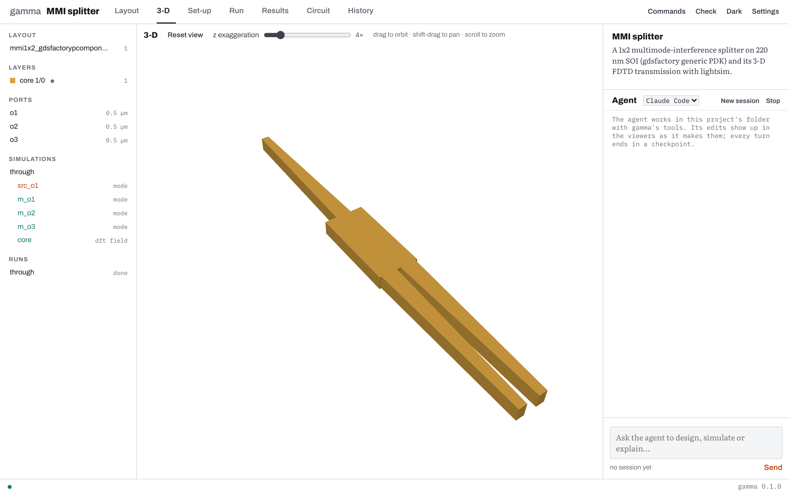
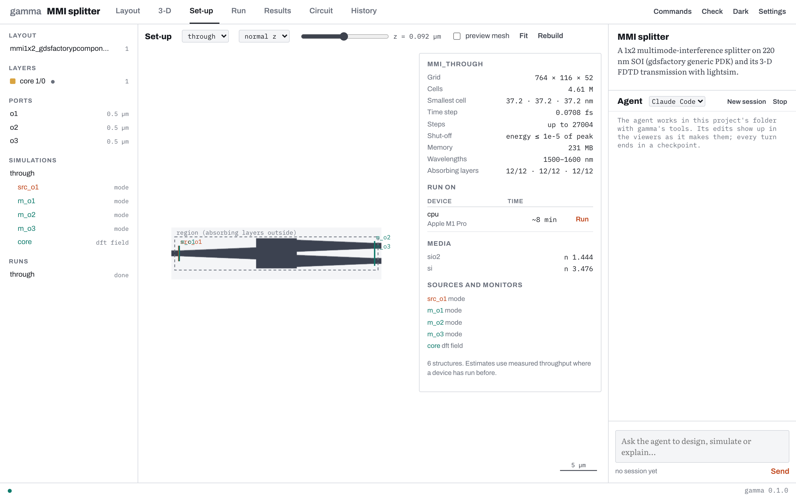
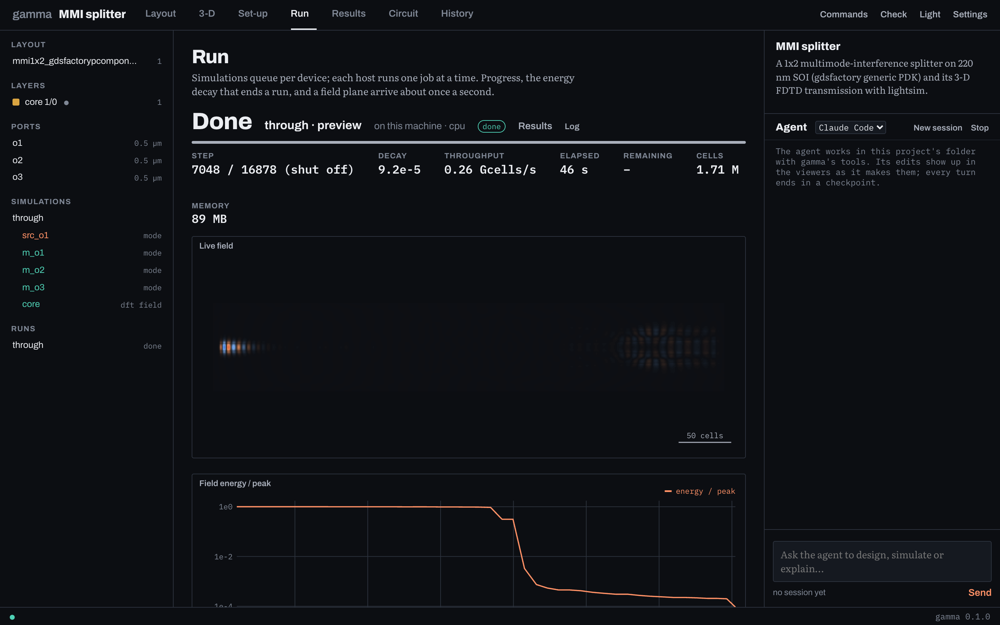

# gamma

**An open-source workspace for designing, simulating and testing photonic
integrated circuits, built for AI agents.** gamma covers the working loop of
the Lumerical interface — layout and object tree, layer stack and materials,
mesh, sources and monitors, run, results — on top of
[lightsim](https://github.com/su3co/lightsim), SU3 Labs' GPU FDTD solver,
with lightsim-quantum for circuits of quantum light to follow. The agent of
your choice (Claude Code, Codex, or any MCP client) works in the same project
with the same tools you use, and every view follows its edits as it makes
them.


- **Projects are folders of text under git**: gdsfactory Python or YAML for
  layout, `stack.toml` for the layer stack, lightsim JSON for simulations.
  Nothing is locked in a binary project file.
- **Viewers**: layout (GDS layers, cells, ports, measuring), 3-D (extruded
  stack), set-up (the permittivity lightsim's own rasteriser produces on its
  own grid, mesh lines, sources, monitors, absorbing layers), run (progress,
  energy decay, live field slice), results (S-parameters, spectra, field maps,
  time series), history (checkpoints, layout and result diffs, review
  comments). WebGL2 rendering keeps large layouts interactive.
- **Simulation anywhere**: the CPU engine locally, NVIDIA GPUs on Linux (one
  or several), and GPU servers over SSH — design on a laptop, simulate on an
  RTX PRO 6000 or a GB10, with progress and field slices streamed back.
  Device, memory and time estimates before every run.
- **Built for agents**: an MCP server with 28 tools (inspect layout and
  stack, place and route gdsfactory components, set up and run simulations,
  read results, design-rule and consistency checks, render any view as an
  image), a CLI with the same verbs, skills for gdsfactory and lightsim, a
  design history with a checkpoint at the end of every agent turn, and
  click-to-reference: select a port or monitor and ask about it.
- **One hub per machine** owns the event log, file watching, git, jobs and
  agent processes; the desktop window, browser tabs, the CLI and the MCP
  server are its clients.
- **Desktop app for macOS and Linux** (Windows to follow) with signed
  automatic updates, stable and beta channels, and rollback.

| | |
|---|---|
|  |  |
|  |  |

## Install

| Platform | Package | Updates |
|---|---|---|
| macOS 13+ (Apple silicon) | `gamma_<version>_aarch64.dmg` | automatic (signed feed) |
| Linux x86_64, aarch64 | `gamma_<version>_<arch>.AppImage` | automatic (signed feed) |
| Debian, Ubuntu | `gamma_<version>_<arch>.deb` | apt repository |
| Fedora, RHEL, openSUSE | `gamma-<version>-1.<arch>.rpm` | dnf/zypper repository |
| GPU servers (headless) | `gamma-linux-<arch>-cuda` | `gamma remote install` |

Details, repositories and building from source: [docs/install.md](docs/install.md).

## Quick start

```bash
git clone https://github.com/su3co/gamma && cd gamma
python3 -m venv .venv && .venv/bin/pip install gdsfactory "lightsim @ git+https://github.com/su3co/lightsim" ./python
cargo build --release -p gamma-cli
cd examples/mmi-splitter
sed -i.bak 's|interpreter = "python3"|interpreter = "../../.venv/bin/python"|' gamma.toml
../../target/release/gamma build                 # GDS, ports and the lightsim spec from the scripts
../../target/release/gamma setup through --preview
../../target/release/gamma run through --preview --device cpu
../../target/release/gamma results through --what sparams
```

On an Apple M1 Pro the preview (1.7 M cells) takes about 50 s and gives
|S₂₁|² = |S₃₁|² = −3.13 dB at 1550 nm. Open the same folder in the desktop
app (or `gamma open` for a browser address) to see it. The full walk-through,
including the lightsim examples: [docs/quickstart.md](docs/quickstart.md).

## Agents

```bash
gamma agent setup claude      # writes .mcp.json in the project; then run `claude` there
gamma agent setup codex       # prints the Codex configuration
```

Or use the conversation panel in the app, which runs the agent for you and
checkpoints every turn. Tools and skills: [docs/agents.md](docs/agents.md).

## GPU servers

```bash
gamma remote add gpu user@gpu-server            # your SSH keys, no passwords
gamma remote install gpu --binary gamma-linux-x86_64-cuda
gamma run through --host gpu --device cuda:0
```

A host can name a job-queue command that runs in front of the worker:
[docs/remote.md](docs/remote.md).

## Documentation

- [Architecture](docs/architecture.md): components, processes, data formats, why Tauri
- [Install and update](docs/install.md) · [Quick start](docs/quickstart.md) · [Agents](docs/agents.md) · [Remote GPU hosts](docs/remote.md)
- [Developing gamma](docs/development.md) · [Releasing](docs/release.md) · [Test runs](docs/test-runs/)

## Status

First release candidate (0.1.0, not yet released). macOS and Linux are
built and tested; Windows packaging is configured but untested.
lightsim-quantum integration is limited to reading circuit files until that
library publishes its interface. See [CHANGELOG.md](CHANGELOG.md).

## License

MIT; see [LICENSE](LICENSE). Bundled fonts (Archivo, Literata, IBM Plex Mono)
are under the SIL Open Font License (`assets/fonts/OFL-*.txt`).
