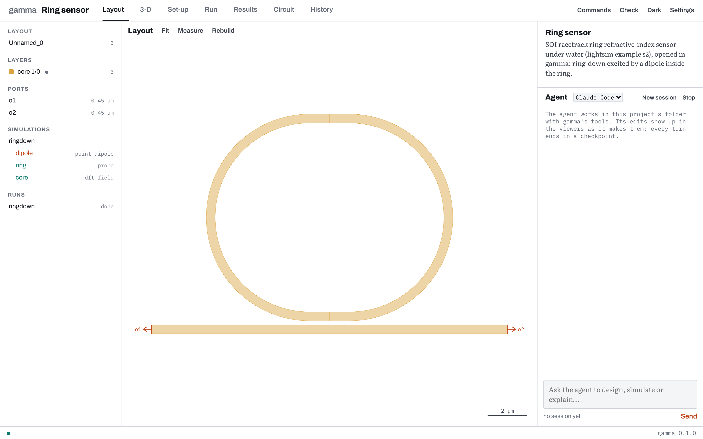
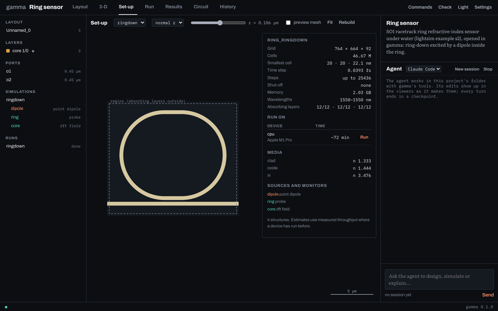

# Quick start

This walk-through opens the MMI example, looks at it, runs it on the CPU and
reads the S-parameters. It takes about five minutes on a laptop.

## 1. Python for the project's scripts

gamma projects describe layouts with gdsfactory and simulations with
lightsim's Python package; gamma runs those scripts to produce the files its
viewers read.

```bash
python3 -m venv ~/.venvs/gamma
~/.venvs/gamma/bin/pip install gdsfactory "lightsim @ git+https://github.com/su3co/lightsim" ./python   # from the gamma checkout
```

In `examples/mmi-splitter/gamma.toml`, point `[python] interpreter` at it
(`~/.venvs/gamma/bin/python`, or a path relative to the project).

## 2. Open the project

Start gamma and open `examples/mmi-splitter`, or from a terminal:

```bash
cd examples/mmi-splitter
gamma build          # runs layout/mmi.py and sims/through.py (full and preview variants)
gamma open           # prints the browser address of the same views
```

- **Layout**: the splitter, its three ports, a scale bar. Scroll to zoom,
  drag to pan, `M` to measure, click a polygon or port to select it.
- **3-D**: the 220 nm silicon core extruded from the stack.
- **Set-up**: the permittivity lightsim will use, on its own grid, with the
  mode source `src_o1`, the mode monitors `m_o1`–`m_o3`, the absorbing
  region and, when zoomed in, the mesh lines. The side panel gives cells,
  steps, memory and a time estimate for every device.

Edit `layout/mmi.py` (say `LENGTH_MMI = 6.0`) and save: gamma rebuilds and
every view updates.

## 3. Run

In Set-up, tick *preview mesh* and press *Run* next to `cpu`, or:

```bash
gamma run through --preview --device cpu
```

The Run view shows progress, the energy decay (the run stops when it falls
below 1e-5 of its peak) and the field in the core plane as it evolves.

## 4. Results

The Results view (or `gamma results through --what sparams`) shows
|S|² in dB over 1.50–1.60 µm, the values at 1550 nm, and |E|² in the core
plane. On an Apple M1 Pro the preview (1.7 M cells) took 49 s and gave
|S₂₁|² = |S₃₁|² = −3.13 dB, reflection −29.7 dB. The full mesh (4.6 M cells)
is a GPU job: 17 s of solver time on one GB10 ([remote.md](remote.md)).

## 5. Ask the agent

Type in the Agent panel, for example: *"Make the MMI 0.5 µm longer, rerun the
preview and compare the splitting with the previous checkpoint."* The agent
edits `layout/mmi.py`, the views follow, it runs the simulation, and the end
of its turn is a checkpoint you can compare in History.

## The lightsim examples

The worked examples published with lightsim (Mach–Zehnder modulator, ring
sensor, grating coupler, quantum circuits…) are gdsfactory designs with
lightsim simulation scripts, and open in gamma with three small files next to
them. For the ring sensor (`s2-ring-sensor`):

`gamma.toml`

```toml
[project]
name = "Ring sensor"

[layout]
gds = "gds/s2-ring-sensor.gds"      # ports come from the gdsfactory metadata in the file
stack = "stack.toml"

[[simulation]]
name = "ringdown"
spec = "build/sims/ringdown.json"
generator = "sims/ringdown.py"

[simulation.preview]
mesh_scale = 2.0
run_time_scale = 0.5
```

`stack.toml`: the 220 nm silicon core on layer 1/0, oxide below, water
above. `sims/ringdown.py`: the example's own builder, written as a spec.

```python
import lightsim as ls
from lightsim.spec import nm
import simulate as S
from gamma_pic import mesh_scale, run_time_scale, write_sim

k = mesh_scale()
sim = S.build(1.333, [20 * nm * k, 20 * nm * k, 22 * nm * k], 1.0e-12 * run_time_scale())
sim.add_source(ls.PointDipole(S.DIPOLE, "Ey", ls.GaussianPulse(S.F0, 0.06 * S.F0), amplitude=1e-12, name="dipole"))
sim.add_monitor(ls.ProbeMonitor("ring", S.PROBE, ["Ey"]))
sim.add_monitor(ls.DFTMonitor("core", [S.XLO, S.YLO, 0.5 * S.T], [S.XHI, S.YHI, 0.5 * S.T], [S.F0]))
write_sim(sim, "ringdown")
```

The full simulation is 46.7 M cells (a GPU job, about 2 GB); the preview,
7.9 M cells, took 3 minutes on an Apple M1 Pro.

| | |
|---|---|
|  |  |
